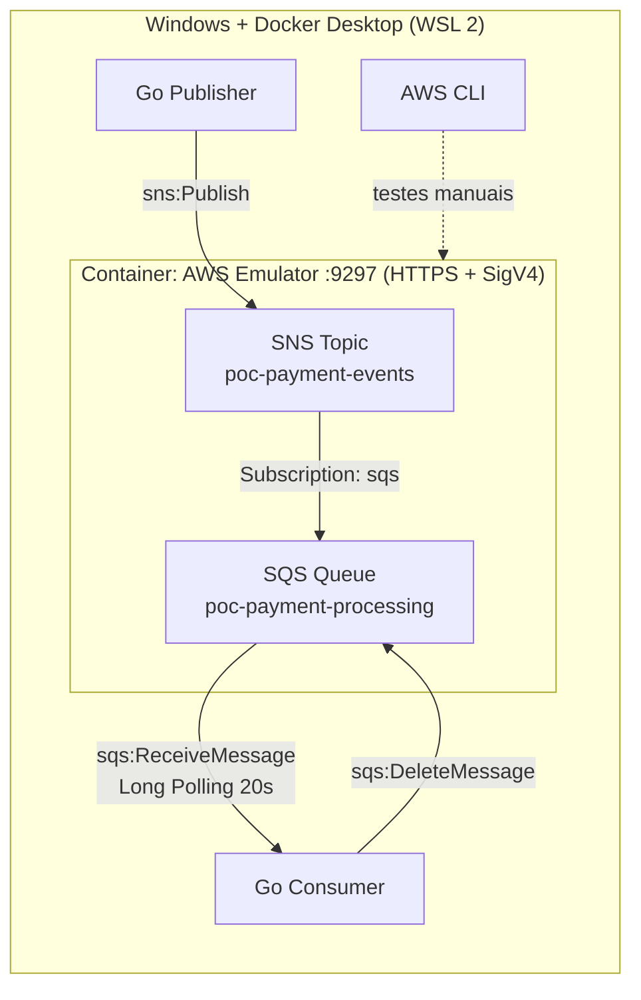
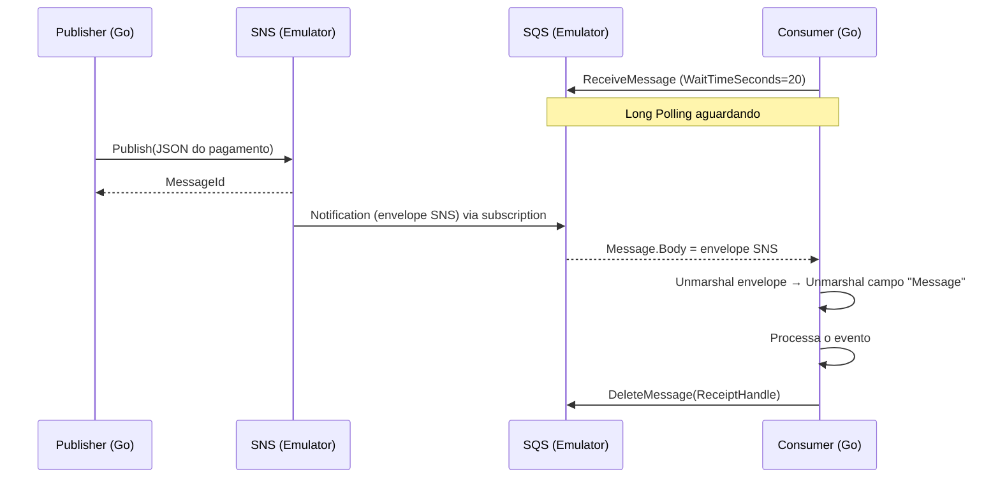

# AWS Emulator POC — SNS → SQS → Go Consumer

> Mensageria assíncrona **100% local** com **Amazon SNS**, **Amazon SQS** e **Go**, usando o **AWS Emulator**, o emulador open source da AWS anunciado em 11/11/2026, rodando em Docker no Windows.


**Testado em:** 20/11/2026 · **Região:** `us-east-1` · **Endpoint:** `https://127.0.0.1:9297`

---

## 🙏 Créditos e inspiração

Esta POC nasceu da publicação do **Daniel Abib** (Senior Specialist Solutions Architect na AWS) no LinkedIn. Todos os créditos a ele pela divulgação e pelo post de lançamento do AWS Emulator.

- Publicação no LinkedIn: <https://lnkd.in/p/di6ZdG7U>
- Post oficial de lançamento: [Test your applications against AWS locally with AWS Emulator](https://aws.amazon.com/blogs/aws/test-your-applications-against-aws-locally-with-aws-emulator/) (AWS News Blog, 11/11/2026)
- Repositório do emulador: <https://github.com/aws/aws-emulator>

Este repositório é um estudo independente e não é um material oficial da AWS.

---

## Sumário

1. [O que é o AWS Emulator](#1-o-que-é-o-aws-emulator)
2. [Visão geral da POC](#2-visão-geral-da-poc)
3. [Arquitetura](#3-arquitetura)
4. [Pré-requisitos](#4-pré-requisitos)
5. [Preparação do Docker no Windows](#5-preparação-do-docker-no-windows)
6. [Construindo a imagem do AWS Emulator](#6-construindo-a-imagem-do-aws-emulator)
7. [Iniciando o AWS Emulator](#7-iniciando-o-aws-emulator)
8. [Apontando AWS CLI e SDK para o emulador](#8-apontando-aws-cli-e-sdk-para-o-emulador)
9. [Criando SNS, SQS, subscription e política](#9-criando-sns-sqs-subscription-e-política)
10. [Implementação em Go](#10-implementação-em-go)
11. [Executando a POC](#11-executando-a-poc)
12. [Testes manuais com AWS CLI](#12-testes-manuais-com-aws-cli)
13. [Comportamentos do emulador observados em SNS e SQS](#13-comportamentos-do-emulador-observados-em-sns-e-sqs)
14. [Limitações do AWS Emulator que importam aqui](#14-limitações-do-aws-emulator-que-importam-aqui)
15. [Troubleshooting](#15-troubleshooting)
16. [Escopo e próximos passos](#16-escopo-e-próximos-passos)
17. [Conclusão](#17-conclusão)
18. [Referências](#18-referências)

---

## 1. O que é o AWS Emulator

O **AWS Emulator** é um emulador local de serviços AWS, escrito em **Rust**, gratuito e de código aberto. Ele expõe um **endpoint HTTPS local** que responde às mesmas APIs usadas na nuvem. Por isso a **AWS CLI**, os **AWS SDKs** e agentes de código (Kiro, Claude Code etc.) conversam com ele sem alterar o código da aplicação.

### Características que sustentam esta POC

| Característica | Como aparece nesta POC |
|---|---|
| **Mesmas APIs da AWS.** É construído a partir dos modelos de API (Smithy) usados pelos SDKs, então requisições e erros têm o mesmo formato da AWS. | O código Go usa o SDK v2 normalmente, sem mocks e sem client customizado. |
| **Endpoint HTTPS local**, por padrão em `127.0.0.1:9297`. | `AWS_ENDPOINT_URL=https://127.0.0.1:9297` redireciona CLI e SDK. |
| **Credenciais, config e CA próprias**, geradas na inicialização e gravadas em `~/.aws/emulator/9297/`. | Volume Docker persiste essa pasta no Windows. |
| **Chaves novas a cada start**, com Access Key ID iniciando em `EMULATOR`. Requisições assinadas com outras chaves são rejeitadas. | Impede o uso acidental de credenciais reais. |
| **SigV4 obrigatório** (como na AWS). | O SDK Go assina normalmente. |
| **Conta única `000000000000`**, sem comportamento entre contas ou regiões. | Todos os ARNs desta POC usam esse account ID. |
| **Health endpoint** em `/__admin/health`. | Usado para confirmar que o emulador subiu. |
| **Operação não implementada retorna HTTP 501**, então o teste falha imediatamente. | Ver [Troubleshooting](#15-troubleshooting). |
| **Fidelity tests** publicados por serviço (k de n), verificados contra a AWS real. | Consulte as pontuações de SNS e SQS na documentação. |
| **Telemetria anônima ligada por padrão**, desativável. | Iniciamos com `--telemetry off`. |
| **No Windows e macOS roda em Docker**; não há imagem pronta publicada. | Construímos a imagem localmente (seção 6). |

> O **modo embedded** (emulador dentro do processo de teste) existe apenas para o AWS SDK for Rust. Como esta POC é em Go, usamos o emulador como **processo/container separado**, via endpoint HTTPS.

---

## 2. Visão geral da POC

1. Uma aplicação Go (**Publisher**) publica um evento JSON de pagamento em um tópico **SNS** emulado.
2. O SNS entrega o evento a uma fila **SQS** emulada, via subscription com protocolo `sqs`.
3. Uma segunda aplicação Go (**Consumer**) recebe a mensagem com **Long Polling** (`WaitTimeSeconds: 20`).
4. O Consumer interpreta o **envelope de notificação do SNS**, extrai o campo `Message` e desserializa o evento de pagamento.
5. Após processar com sucesso, o Consumer executa `DeleteMessage`.

Tudo roda na máquina local: **nenhum recurso é criado em conta AWS real e nenhuma credencial real é usada**.

---

## 3. Arquitetura



### Fluxo de uma mensagem



### Recursos utilizados

| Recurso | Nome | Identificador |
|---|---|---|
| Região | `us-east-1` | — |
| Endpoint local | `https://127.0.0.1:9297` | — |
| SNS Topic | `poc-payment-events` | `arn:aws:sns:us-east-1:000000000000:poc-payment-events` |
| SQS Queue | `poc-payment-processing` | `https://sqs.us-east-1.amazonaws.com/000000000000/poc-payment-processing` |
| SQS Queue ARN | — | `arn:aws:sqs:us-east-1:000000000000:poc-payment-processing` |
| Subscription | SNS → SQS | Protocolo `sqs` |

O account ID `000000000000` é a conta única do emulador, não uma conta AWS real.

---

## 4. Pré-requisitos

| Ferramenta | Observação |
|---|---|
| Windows 10/11 com **WSL 2** | Backend Linux do Docker Desktop |
| **Docker Desktop** | Executa o AWS Emulator em container |
| **AWS CLI v2** | Para criar recursos e inspecionar o fluxo |
| **Go 1.24** + **AWS SDK for Go v2** | Publisher e Consumer |
| **PowerShell** | Todos os comandos deste guia |

Variáveis e comandos deste guia estão em PowerShell. No Linux/macOS a lógica é a mesma, mudando apenas a sintaxe de variáveis de ambiente (`export`).

---

## 5. Preparação do Docker no Windows

### 5.1. Atualizar o WSL

```powershell
wsl --update
wsl --shutdown
```

O `wsl --shutdown` encerra as distribuições. O WSL reinicia na próxima utilização.

### 5.2. Verificar o Docker

```powershell
docker info
```

O comando deve exibir **Client** e **Server**. Se aparecer erro de conexão com `dockerDesktopLinuxEngine`, abra o Docker Desktop e aguarde a inicialização.

```powershell
wsl --list --verbose
```

Com o Docker Desktop ativo, a distribuição `docker-desktop` aparece com versão `2`.

---

## 6. Construindo a imagem do AWS Emulator

No Windows (e no macOS), a AWS **não publica uma imagem pronta**. É preciso construir uma a partir de um Dockerfile curto, que instala o pacote RPM oficial sobre o Amazon Linux 2023.

```powershell
New-Item -ItemType Directory -Force "$env:USERPROFILE\aws-emulator-poc"
Set-Location "$env:USERPROFILE\aws-emulator-poc"
```

Crie o arquivo `Dockerfile` (sem extensão `.txt`):

```dockerfile
FROM public.ecr.aws/amazonlinux/amazonlinux:2023-minimal

ADD https://downloads.aws.com/aws-emulator/packages/aws-emulator/LTS/latest/aws-emulator-x86_64.rpm /tmp/aws-emulator.rpm

RUN rpm -i /tmp/aws-emulator.rpm \
    && rm /tmp/aws-emulator.rpm \
    && mkdir -p /home/emulator \
    && chown 1000 /home/emulator

USER 1000
ENTRYPOINT ["aws-emulator"]
```

> **Sobre `USER` e `ENTRYPOINT`:** o comando `docker run ... aws-emulator -p 9297 --telemetry off` da seção 7 só funciona se o `ENTRYPOINT` for o binário `aws-emulator`, pois é ele que recebe `-p` e `--telemetry`. O `USER 1000` é coerente com o `chown 1000 /home/emulator`. Se o Dockerfile da documentação oficial tiver instruções adicionais, **prevalece o oficial**.

O pacote RPM instala o comando `aws-emulator` em `/usr/bin/`. Para versões `arm64` ou para o pacote Debian, consulte a documentação oficial.

```powershell
docker build -t aws-emulator .
docker images
```

Nos logs desta execução, `aws-emulator:latest` foi criada com sucesso (≈ 2,03 GB de uso em disco, 577 MB de conteúdo).

---

## 7. Iniciando o AWS Emulator

O emulador grava credenciais, `config` e certificado CA em `~/.aws/emulator/<porta>/`. Para que esses arquivos fiquem acessíveis no Windows (e sobrevivam ao `--rm`), montamos um volume:

```powershell
New-Item -ItemType Directory -Force "$env:USERPROFILE\.aws\emulator"

$port = 9297

docker run --rm --memory=2g --memory-swap=2g `
  -p "127.0.0.1:${port}:${port}" `
  -v "$env:USERPROFILE\.aws\emulator:/home/emulator/.aws/emulator" `
  aws-emulator -p $port --telemetry off
```

| Opção | Finalidade |
|---|---|
| `--rm` | Remove o container ao encerrar |
| `--memory=2g` / `--memory-swap=2g` | Limita memória e swap a 2 GB |
| `-p 127.0.0.1:9297:9297` | Publica a porta **somente no loopback**, então só a própria máquina acessa o emulador |
| `-v ...\.aws\emulator:/home/emulator/.aws/emulator` | Persiste credenciais, config e CA no Windows |
| `aws-emulator -p 9297` | Inicia o emulador na porta 9297 |
| `--telemetry off` | Desativa o envio de dados anônimos de uso e erro |

Mantenha esse terminal aberto durante toda a POC. O emulador escreve o log em **JSON lines**.

### 7.1. Arquivos gerados

Com o emulador no ar, liste a pasta no Windows:

```powershell
Get-ChildItem "$env:USERPROFILE\.aws\emulator\9297"
```

Devem existir, segundo o post de lançamento:

| Arquivo | Uso |
|---|---|
| `emulator_credentials` | Credenciais locais (Access Key ID começa com `EMULATOR`) |
| `config` | Config do AWS CLI/SDK apontando para o emulador |
| `ca.pem` | CA própria do emulador, necessária para confiar no HTTPS local |

> **Atenção:** o emulador **gera chaves novas a cada inicialização**. Se você reiniciar o container, reinicie também o Consumer e qualquer processo que tenha lido as credenciais anteriores.

### 7.2. Verificar a inicialização

O log deve indicar:

```text
endpoint_url: https://127.0.0.1:9297
health_check_url: https://127.0.0.1:9297/__admin/health
```

```powershell
curl.exe --cacert "$env:USERPROFILE\.aws\emulator\9297\ca.pem" `
  https://127.0.0.1:9297/__admin/health
```

Resultado esperado:

```text
ok
```

---

## 8. Apontando AWS CLI e SDK para o emulador

O ponto central da proposta do AWS Emulator: **o código não muda**, só o ambiente. Crie um arquivo `env.ps1` na raiz do projeto:

```powershell
# env.ps1 — aponta CLI e SDK para o AWS Emulator
$emu = "$env:USERPROFILE\.aws\emulator\9297"

# Endpoint e região
$env:AWS_ENDPOINT_URL                  = "https://127.0.0.1:9297"
$env:AWS_REGION                        = "us-east-1"
$env:AWS_DEFAULT_REGION                = "us-east-1"

# Credenciais, config e CA gerados pelo emulador
$env:AWS_SHARED_CREDENTIALS_FILE       = "$emu\emulator_credentials"
$env:AWS_CONFIG_FILE                   = "$emu\config"
$env:AWS_CA_BUNDLE                     = "$emu\ca.pem"

# Evita chamadas à AWS real / ao IMDS
$env:AWS_EC2_METADATA_DISABLED         = "true"
$env:AWS_DISABLE_HOST_PREFIX_INJECTION = "true"

# Garante que nenhuma credencial real seja usada
Remove-Item Env:AWS_ACCESS_KEY_ID, Env:AWS_SECRET_ACCESS_KEY, `
            Env:AWS_SESSION_TOKEN, Env:AWS_PROFILE -ErrorAction SilentlyContinue

# Variáveis da POC
$env:SNS_TOPIC_ARN = "arn:aws:sns:us-east-1:000000000000:poc-payment-events"
$env:SQS_QUEUE_URL = "https://sqs.us-east-1.amazonaws.com/000000000000/poc-payment-processing"
```

Carregue em **cada novo terminal** (use o ponto + espaço, *dot-sourcing*, para que as variáveis valham na sessão atual):

```powershell
. .\env.ps1
```

### Por que cada variável importa

| Variável | Motivo |
|---|---|
| `AWS_ENDPOINT_URL` | Redireciona CLI e SDKs para o emulador. Com ela definida, **`--endpoint-url` deixa de ser necessário** nos comandos. |
| `AWS_SHARED_CREDENTIALS_FILE` / `AWS_CONFIG_FILE` | Usam as credenciais `EMULATOR*` geradas na inicialização. Chaves de outra origem são rejeitadas. |
| `AWS_CA_BUNDLE` | O endpoint HTTPS usa uma CA própria. Sem ela, ocorrem erros de certificado (`x509`). O AWS SDK for Go v2 respeita essa variável. |
| `AWS_EC2_METADATA_DISABLED` | Impede o SDK de procurar credenciais no IMDS. |
| `AWS_DISABLE_HOST_PREFIX_INJECTION` | Recomendada no post de lançamento para o cenário local. |
| `Remove-Item Env:AWS_ACCESS_KEY_ID...` | Evita que credenciais reais da sessão atrapalhem (ou vazem para) a execução local. |

> No SDK for Java, por exemplo, é preciso configurar o *trust store* para o certificado do emulador. No Go, `AWS_CA_BUNDLE` resolve.

### 8.1. Validar a identidade local

```powershell
aws sts get-caller-identity
```

Deve retornar a conta `000000000000`. Essa identidade **não** representa uma identidade IAM real.

---

## 9. Criando SNS, SQS, subscription e política

Com o `env.ps1` carregado, nenhum comando precisa de `--endpoint-url` ou `--region`.

### 9.1. Criar a fila SQS

```powershell
aws sqs create-queue --queue-name poc-payment-processing
```

```json
{
  "QueueUrl": "https://sqs.us-east-1.amazonaws.com/000000000000/poc-payment-processing"
}
```

### 9.2. Criar o tópico SNS

```powershell
aws sns create-topic --name poc-payment-events
```

```json
{
  "TopicArn": "arn:aws:sns:us-east-1:000000000000:poc-payment-events"
}
```

### 9.3. Criar a subscription SNS → SQS

```powershell
aws sns subscribe `
  --topic-arn $env:SNS_TOPIC_ARN `
  --protocol sqs `
  --notification-endpoint arn:aws:sqs:us-east-1:000000000000:poc-payment-processing
```

### 9.4. Política da fila: autorizar o SNS a enviar mensagens

Criar a subscription **não basta**. A fila precisa permitir `sqs:SendMessage` para o serviço SNS, restrito ao tópico de origem. Sem isso, o emulador registra este aviso e **retém a notificação**:

```text
the subscribed queue's policy does not allow this service to send it a message,
so the notification is withheld
```

Crie `sqs-queue-policy.json`:

```json
{
  "Version": "2012-10-17",
  "Statement": [
    {
      "Sid": "AllowSNSPublishToQueue",
      "Effect": "Allow",
      "Principal": { "Service": "sns.amazonaws.com" },
      "Action": "sqs:SendMessage",
      "Resource": "arn:aws:sqs:us-east-1:000000000000:poc-payment-processing",
      "Condition": {
        "ArnEquals": {
          "aws:SourceArn": "arn:aws:sns:us-east-1:000000000000:poc-payment-events"
        }
      }
    }
  ]
}
```

O atributo `Policy` do SQS é uma **string JSON dentro de outro JSON**. O script abaixo monta o arquivo corretamente, sem BOM:

```powershell
$attributes = @{
    Policy = (Get-Content .\sqs-queue-policy.json -Raw)
} | ConvertTo-Json -Compress

[System.IO.File]::WriteAllText(
    "$PWD\queue-attributes.json",
    $attributes,
    [System.Text.UTF8Encoding]::new($false)
)

aws sqs set-queue-attributes `
  --queue-url $env:SQS_QUEUE_URL `
  --attributes file://queue-attributes.json
```

> **Importante:** o AWS Emulator **não avalia políticas IAM e resource-based como a AWS faz** (ver [seção 14](#14-limitações-do-aws-emulator-que-importam-aqui)). Aplique esta política mesmo assim: ela é **obrigatória na AWS real** e mantém o seu código/infra pronto para produção. Mas não trate o comportamento do emulador como validação de segurança.

### 9.5. Conferir os recursos

```powershell
aws sns list-topics
aws sqs list-queues
aws sns list-subscriptions-by-topic --topic-arn $env:SNS_TOPIC_ARN
aws sqs get-queue-attributes --queue-url $env:SQS_QUEUE_URL --attribute-names Policy
```

Resultado observado da subscription:

```json
{
  "Subscriptions": [
    {
      "SubscriptionArn": "arn:aws:sns:us-east-1:000000000000:poc-payment-events:63e7451b-b63e-4936-b099-94c6d82d172e",
      "Owner": "000000000000",
      "Protocol": "sqs",
      "Endpoint": "arn:aws:sqs:us-east-1:000000000000:poc-payment-processing",
      "TopicArn": "arn:aws:sns:us-east-1:000000000000:poc-payment-events"
    }
  ]
}
```

---

## 10. Implementação em Go

### Estrutura do projeto

```text
aws-emulator-poc-sqs-sns/
├── cmd/
│   ├── publisher/main.go
│   └── consumer/main.go
├── config/
│   └── config.go
├── internal/
│   └── messaging/
│       ├── sns.go
│       └── sqs.go
├── env.ps1
├── sqs-queue-policy.json
├── go.mod
└── README.md
```

### 10.1. Nenhuma configuração específica do emulador no código

O AWS SDK for Go v2 lê `AWS_ENDPOINT_URL`, `AWS_CA_BUNDLE`, `AWS_SHARED_CREDENTIALS_FILE` e `AWS_CONFIG_FILE` pela cadeia padrão. O mesmo binário funciona no emulador e na AWS real, mudando só o ambiente:

```go
// Trecho ilustrativo e simplificado
cfg, err := config.LoadDefaultConfig(ctx)
if err != nil {
    log.Fatalf("load aws config: %v", err)
}

snsClient := sns.NewFromConfig(cfg)
sqsClient := sqs.NewFromConfig(cfg)
```

### 10.2. Publisher

1. Cria o evento de pagamento.
2. Serializa em JSON.
3. Chama `sns:Publish` no tópico `SNS_TOPIC_ARN`.
4. Exibe o `MessageId` retornado.

Evento publicado:

```json
{
  "paymentId": "pay-go-001",
  "amount": 150.5,
  "currency": "BRL",
  "method": "PIX",
  "status": "PENDING",
  "createdAt": "2026-11-20T13:17:57Z"
}
```

`createdAt` é gerado em UTC na execução; horário e milissegundos variam.

### 10.3. Consumer

Fluxo contínuo:

1. `ReceiveMessage` com `WaitTimeSeconds: 20` (Long Polling).
2. Desserializa `Body` como **envelope SNS**.
3. Desserializa o campo `Message` como evento de pagamento.
4. Processa (aqui, simulado com log).
5. `DeleteMessage` **somente após sucesso**.

```go
// Trecho ilustrativo e simplificado
type snsEnvelope struct {
    Type      string `json:"Type"`
    MessageID string `json:"MessageId"`
    TopicArn  string `json:"TopicArn"`
    Message   string `json:"Message"`
    Timestamp string `json:"Timestamp"`
}

out, err := sqsClient.ReceiveMessage(ctx, &sqs.ReceiveMessageInput{
    QueueUrl:            aws.String(queueURL),
    MaxNumberOfMessages: 5,
    WaitTimeSeconds:     20,
})

for _, m := range out.Messages {
    var env snsEnvelope
    if err := json.Unmarshal([]byte(*m.Body), &env); err != nil { /* log e continue */ }

    var payment map[string]any
    if err := json.Unmarshal([]byte(env.Message), &payment); err != nil { /* log e continue */ }

    // ... processa o evento ...

    _, err = sqsClient.DeleteMessage(ctx, &sqs.DeleteMessageInput{
        QueueUrl:      aws.String(queueURL),
        ReceiptHandle: m.ReceiptHandle,
    })
}
```

### 10.4. Envelope de notificação SNS

O SQS **não** recebe só o JSON do pagamento. Por padrão, o SNS entrega um envelope:

```json
{
  "Type": "Notification",
  "MessageId": "84f8ece1-745a-472c-8f9d-4431e9e6cf0a",
  "TopicArn": "arn:aws:sns:us-east-1:000000000000:poc-payment-events",
  "Message": "{\"paymentId\":\"pay-go-001\",\"amount\":150.5,\"currency\":\"BRL\",\"method\":\"PIX\",\"status\":\"PENDING\"}",
  "Timestamp": "2026-11-20T13:17:57.067Z"
}
```

O emulador reproduz esse comportamento, e é por isso que o Consumer faz **dois `Unmarshal`**: primeiro o envelope, depois o conteúdo de `Message`.

### 10.5. Visibility Timeout e `DeleteMessage`

- Receber uma mensagem **não a remove**: ela fica invisível durante o *Visibility Timeout*.
- O `ReceiptHandle` é único **por recebimento**.
- Se o processamento falhar e o Consumer **não** executar `DeleteMessage`, a mensagem reaparece após o Visibility Timeout.

---

## 11. Executando a POC

### Checklist

- [ ] Docker Desktop ativo
- [ ] Container do AWS Emulator em execução (terminal aberto)
- [ ] `/__admin/health` retorna `ok`
- [ ] `. .\env.ps1` carregado **neste** terminal
- [ ] Tópico, fila, subscription e política criados (seção 9)

### Terminal 1: Consumer

```bash
. .\env.ps1
go run ./cmd/consumer
```

```text
2026/11/20 10:17:44 SQS CONSUMER STARTED
```

### Terminal 2: Publisher

```bash
. .\env.ps1
go run ./cmd/publisher
```

### Log real da execução validada

```text
2026/11/20 10:17:44 SQS CONSUMER STARTED
2026/11/20 10:17:44

========== SQS CONSUMER ==========
SNS Notification received!
SNS Message ID: 84f8ece1-745a-472c-8f9d-4431e9e6cf0a
SNS Topic ARN: arn:aws:sns:us-east-1:000000000000:poc-payment-events
SNS Timestamp: 2026-11-20T13:17:57.067Z
-----------------------------------
Payment event processed:
map[amount:150.5 createdAt:2026-11-20T13:17:57.0251837Z currency:BRL method:PIX paymentId:pay-go-001 status:PENDING]
-----------------------------------
Message deleted successfully!
===================================
```

Esse log comprova, **contra o AWS Emulator**: entrega SNS → SQS, extração do envelope, processamento e exclusão da mensagem.

---

## 12. Testes manuais com AWS CLI

Com o `env.ps1` carregado, os comandos usam o emulador automaticamente.

### 12.1. Publicar no SNS

```powershell
aws sns publish --topic-arn $env:SNS_TOPIC_ARN --message "Payment event from SNS!"
```

```json
{ "MessageId": "4ff477ee-f9b9-415e-8fe6-53ab1a754c97" }
```

### 12.2. Receber no SQS

```powershell
aws sqs receive-message --queue-url $env:SQS_QUEUE_URL --max-number-of-messages 5
```

Durante os testes a fila retornou dois tipos de mensagem:

- Uma mensagem simples enviada diretamente: `Hello from AWS Emulator!`.
- Uma notificação SNS com o envelope (`Type`, `MessageId`, `TopicArn`, `Message`, `Timestamp`).

Essa inspeção mostra exatamente como o SNS encapsula a mensagem antes de entregá-la ao SQS.

### 12.3. Excluir uma mensagem

```powershell
aws sqs delete-message `
  --queue-url $env:SQS_QUEUE_URL `
  --receipt-handle "<RECEIPT_HANDLE_RETORNADO_PELO_RECEIVE>"
```

Use o `ReceiptHandle` exato retornado pelo `receive-message` daquela entrega. Placeholder, handle antigo ou copiado errado resultam em `ReceiptHandleIsInvalid`.

### 12.4. Consultar quantidade de mensagens

```powershell
aws sqs get-queue-attributes `
  --queue-url $env:SQS_QUEUE_URL `
  --attribute-names ApproximateNumberOfMessages ApproximateNumberOfMessagesNotVisible
```

| Atributo | Significado |
|---|---|
| `ApproximateNumberOfMessages` | Mensagens aproximadamente disponíveis para recebimento |
| `ApproximateNumberOfMessagesNotVisible` | Mensagens recebidas e ainda dentro do Visibility Timeout |

Após consumo e exclusão:

```json
{
  "Attributes": {
    "ApproximateNumberOfMessagesNotVisible": "0",
    "ApproximateNumberOfMessages": "0"
  }
}
```

### 12.5. Limpar a fila

```powershell
aws sqs purge-queue --queue-url $env:SQS_QUEUE_URL
```

Remove **todas** as mensagens da fila. Útil para voltar a um estado conhecido entre testes.

---

## 13. Comportamentos do emulador observados em SNS e SQS

| Observação | Detalhe |
|---|---|
| **Envelope SNS reproduzido** | O corpo no SQS vem encapsulado (`Type: Notification`), como na AWS. |
| **Aviso de política da fila** | Sem `sqs:SendMessage` para o tópico, o emulador registra um aviso e **retém** a notificação. |
| **Visibility Timeout / ReceiptHandle** | `ReceiptHandleIsInvalid` ocorre com handle inválido ou desatualizado. |
| **Long Polling** | `WaitTimeSeconds: 20` funcionou no Consumer sem ajustes. |
| **Purge** | `purge-queue` limpou mensagens de testes anteriores. |
| **Contagem de mensagens** | `ApproximateNumber*` refletiu consumo e exclusão. |

> Estas são observações **desta execução**, em um produto recém-lançado. A fidelidade varia por serviço e funcionalidade, então consulte as pontuações de SNS e SQS na documentação do AWS Emulator.

---

## 14. Limitações do AWS Emulator que importam aqui

Segundo o post de lançamento:

| Limitação | Impacto nesta POC |
|---|---|
| **Não avalia políticas IAM e resource-based como a AWS** | Uma requisição que a AWS negaria pode funcionar no emulador. **Não use o emulador para validar segurança.** Teste a política da fila (seção 9.4) na AWS real antes de produção. |
| **Conta única, sem comportamento entre contas ou regiões** | Não é possível testar, por exemplo, SNS e SQS em contas diferentes. |
| **Fidelidade varia por serviço/feature** | Comportamentos avançados de SNS/SQS podem diferir da AWS. |
| **Operação não implementada → HTTP 501** | O teste falha imediatamente. Se isso ocorrer, abra uma issue no repositório. |
| **Chaves novas a cada inicialização** | Reinicie processos que mantêm credenciais carregadas. |
| **Produto recém-lançado (GA em 11/11/2026)** | Espere evolução rápida; o score de fidelidade pode oscilar conforme novos testes são adicionados. |

Se notar diferença entre o emulador e a AWS, a recomendação do post é abrir uma issue em <https://github.com/aws/aws-emulator>.

---

## 15. Troubleshooting

| Sintoma | Causa provável | Solução |
|---|---|---|
| `docker info` mostra erro de `dockerDesktopLinuxEngine` | Docker Engine indisponível | `wsl --update`, `wsl --shutdown`, reabrir o Docker Desktop e aguardar |
| `failed to read dockerfile: open Dockerfile: no such file or directory` | Arquivo criado como `Dockerfile.txt` | `Rename-Item Dockerfile.txt Dockerfile` |
| `docker run` falha ao interpretar `-p` ou `--telemetry` | Imagem sem `ENTRYPOINT ["aws-emulator"]` | Ajustar o Dockerfile (seção 6) e reconstruir |
| Erro de certificado (`x509: certificate signed by unknown authority`) | CLI/SDK não confia na CA do emulador | Definir `AWS_CA_BUNDLE` para `...\9297\ca.pem` |
| Erro de assinatura ou credencial inválida | Usando chaves que não são `EMULATOR*`, ou emulador reiniciado | Carregar `env.ps1`, remover `AWS_ACCESS_KEY_ID`/`AWS_SECRET_ACCESS_KEY` e reiniciar o processo |
| Conexão recusada em `127.0.0.1:9297` | Container parado ou porta diferente | Conferir o terminal do emulador e o `/__admin/health` |
| Aviso de *queue policy ... notification is withheld* | Fila sem permissão para o SNS | Aplicar a política da seção 9.4 |
| Mensagem publicada mas Consumer não recebe | Subscription ou política ausente | Conferir seção 9.5 |
| HTTP **501 Not Implemented** | Operação ainda não implementada no emulador | Verificar a documentação e, se for o caso, abrir issue |
| `ReceiptHandleIsInvalid` | Placeholder, handle antigo ou copiado errado | Usar o handle do `receive-message` correspondente |
| Fila ainda mostra 1 mensagem após consumir | Mensagem de teste avulsa (`Hello from AWS Emulator!`) | `purge-queue` para voltar a um estado conhecido |
| Variáveis sumiram em outro terminal | Variáveis `$env:` valem só na sessão | Rodar `. .\env.ps1` no novo terminal |

---

## 16. Escopo e próximos passos

### Implementado

- [x] AWS Emulator em Docker (imagem construída localmente)
- [x] Endpoint HTTPS local com CA, credenciais e config do emulador
- [x] Tópico SNS, fila SQS e subscription `sqs`
- [x] Política da fila autorizando o SNS
- [x] Publisher em Go (SNS Publish)
- [x] Consumer em Go com Long Polling
- [x] Tratamento do envelope SNS e extração do evento
- [x] `DeleteMessage` após sucesso
- [x] Testes manuais com AWS CLI

### Fora do escopo

- Banco de dados ou persistência de pagamentos
- Idempotência
- Dead Letter Queue (DLQ) e estratégia de retry customizada
- Regras de negócio reais de pagamentos
- Observabilidade e infraestrutura de produção

### Ideias para evoluir (ainda não testadas)

- Testar `RawMessageDelivery` na subscription, eliminando o envelope SNS.
- Adicionar DLQ com `RedrivePolicy` e `maxReceiveCount`, e conferir como o emulador se comporta.
- Testar filtros de subscription (`FilterPolicy`) com `MessageAttributes`.
- Usar filas FIFO (`.fifo`) e tópicos FIFO.
- Subir o emulador em pipelines de CI usando o `/__admin/health` como *wait-for-ready*.
- Escrever testes de integração em Go que sobem o emulador e validam o fluxo ponta a ponta.

---

## 17. Conclusão

O AWS Emulator permite rodar, **na própria máquina**, o padrão **publish/subscribe** (SNS) com processamento assíncrono (SQS) usando as **mesmas APIs, CLI e SDK** que serão usados na AWS real. O Publisher não conhece o Consumer: ele publica no tópico, a subscription entrega à fila, e o Consumer busca, interpreta o envelope, processa e confirma com `DeleteMessage`.

O código Go permanece igual. O que muda é o ambiente (`AWS_ENDPOINT_URL`, CA e credenciais do emulador). O ganho é um ciclo de feedback rápido, sem custo e sem risco de tocar uma conta real. A contrapartida é lembrar que o emulador **não substitui testes de segurança e de IAM** na AWS antes de ir para produção.

---

## 18. Referências

- [Test your applications against AWS locally with AWS Emulator — AWS News Blog](https://aws.amazon.com/blogs/aws/test-your-applications-against-aws-locally-with-aws-emulator/)
- [aws/aws-emulator — GitHub](https://github.com/aws/aws-emulator)
- [Publicação de Daniel Abib no LinkedIn](https://lnkd.in/p/di6ZdG7U)
- [Amazon SNS — documentação](https://docs.aws.amazon.com/sns/)
- [Amazon SQS — documentação](https://docs.aws.amazon.com/sqs/)
- [AWS SDK for Go v2](https://aws.github.io/aws-sdk-go-v2/)

---

**Projeto:** `aws-emulator-poc-sqs-sns` · **Região:** `us-east-1` · **Endpoint local:** `https://127.0.0.1:9297`

**Créditos pela inspiração:** [Daniel Abib](https://lnkd.in/p/di6ZdG7U)
